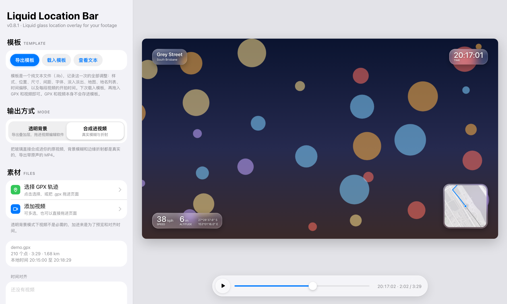
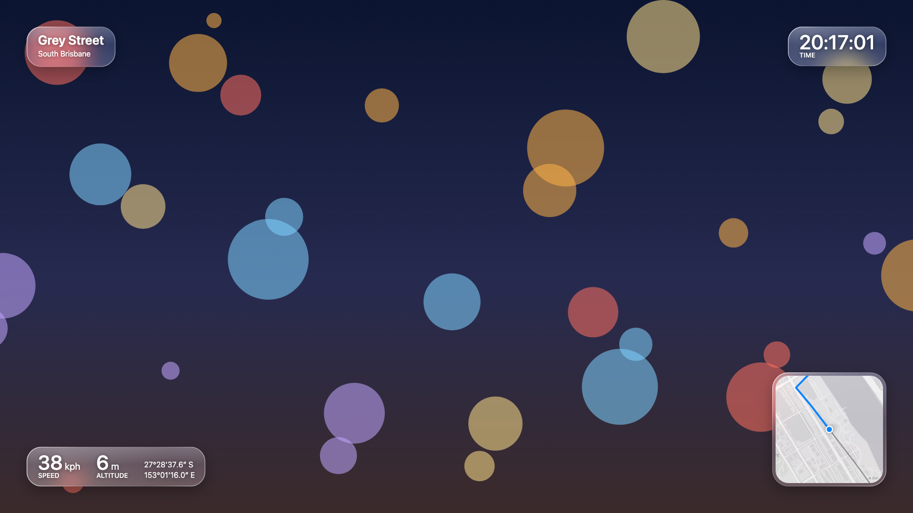
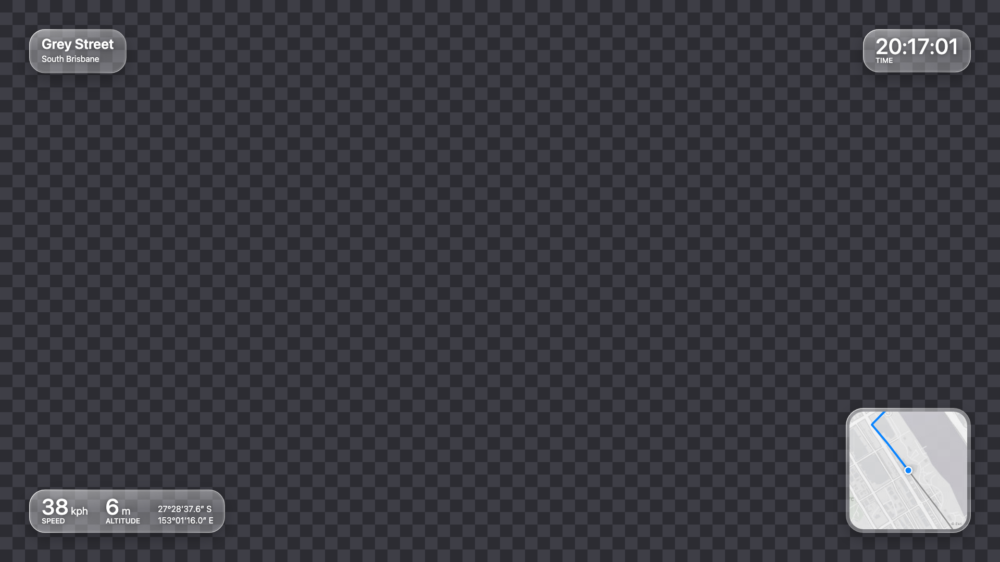
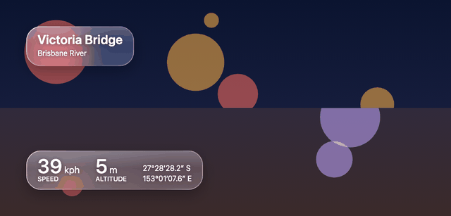
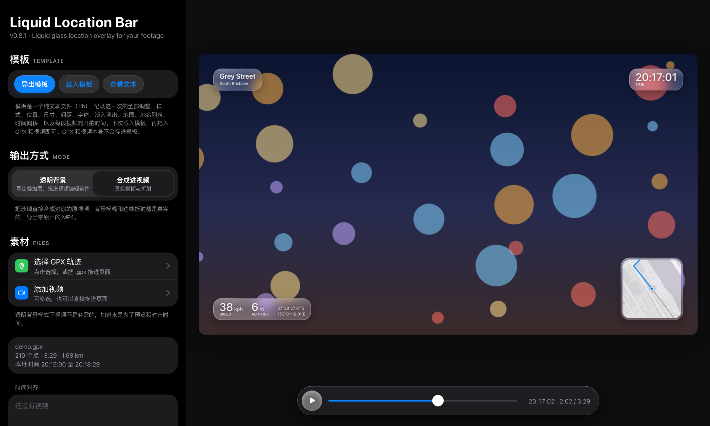
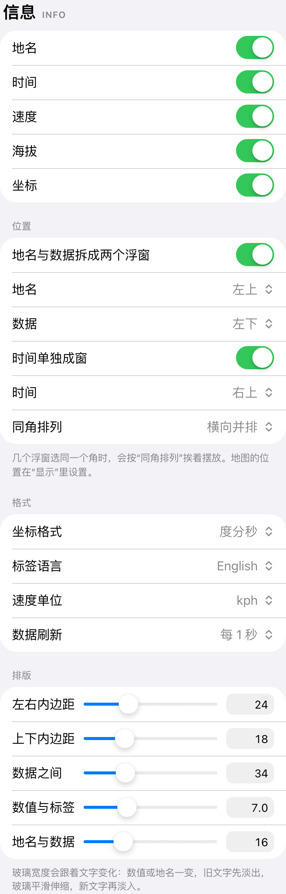
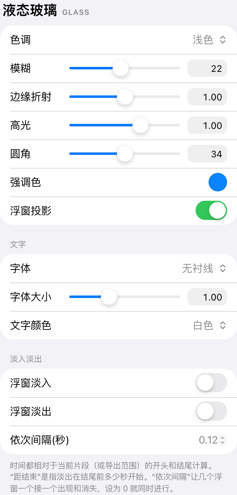
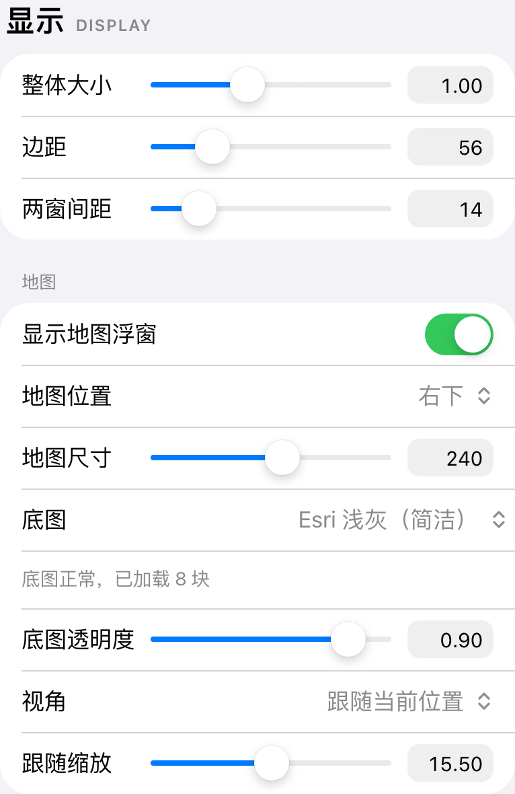
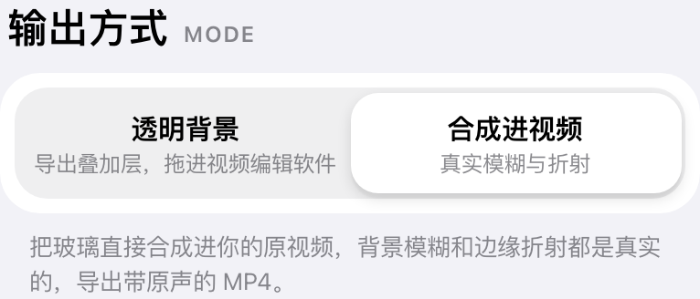
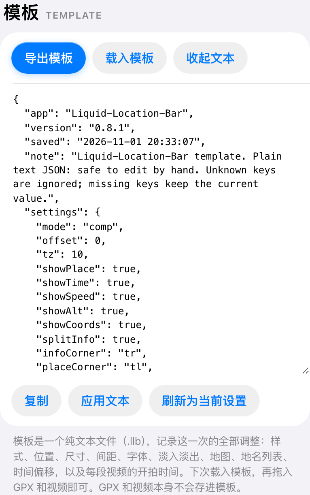

<p align="center"></p>

# Liquid Location Bar

<p align="center">
  <a href="LICENSE"></a>
  
  
  
  <a href="https://github.com/ShinyAkira106"></a>
</p>

简体中文 · English（界面为简体中文 / interface in Simplified Chinese）

一个单文件网页工具：把拍摄时记录的 GPS 轨迹，变成叠加在视频上的液态玻璃位置浮窗。浮窗里有实时小地图、地名、速度、海拔、时间和坐标，数值变化时玻璃会平滑伸缩。可以导出带透明通道的叠加层，直接拖进视频编辑软件，也可以把浮窗合成进原视频，得到真实的背景模糊和边缘折射。不需要安装，也不需要插件。

A single file web tool that turns the GPS track you recorded while filming into a liquid glass location overlay for your videos: a live mini map, place names, speed, altitude, time and coordinates, with glass that smoothly resizes as the values change. Export a transparent overlay to drop straight into your video editor, or composite the panels into your footage for real background blur and edge refraction. Nothing to install and no plugins.

<p align="center">
  
</p>
主界面：左边是分组的设置栏，右边是始终完整显示的预览和悬浮的玻璃播放栏。

The main window: grouped settings on the left, and a preview that always fits on the right with a floating glass play bar.

## 使用 / Getting started

先在手机上记录轨迹。任何能导出 GPX 的应用都可以，BasicAirData 的 GPS Logger 和 mendhak 的 GPSLogger 都小巧、免费、开源。记录间隔设为 1 秒；安卓手机要允许它在后台运行并关掉电池优化，否则打开相机时轨迹可能断档。

First record a track on your phone. Any app that exports GPX works; GPS Logger by BasicAirData and GPSLogger by mendhak are both small, free and open source. Set the interval to one second, and on Android let the app run in the background with battery optimisation off, otherwise the track may have gaps while the camera is open.

从 [Releases](https://github.com/ShinyAkira106/liquid-location-bar/releases) 下载 `liquid-location-bar.html`（或者直接下载仓库里的同名文件），用电脑上的 Chrome 或 Edge 打开。选择 GPX 文件，再添加视频。文件名里带时间的视频（例如 `VID20261026224810.mp4`）会自动读出开拍时间，读不到时用视频自带的时间信息，也可以手动修改。定位点和画面整体偏早或偏晚时，调“全局偏移”。想先试试，可以载入仓库里的 `samples/demo.gpx` 和 `samples/demo-template.llb`。

Download `liquid-location-bar.html` from [Releases](https://github.com/ShinyAkira106/liquid-location-bar/releases) (or the same file in this repository) and open it in Chrome or Edge on a computer. Choose your GPX file and add your clips. A clip whose filename contains a timestamp (for example `VID20261026224810.mp4`) gets its start time from the name, otherwise from the video's own metadata, and you can always edit it by hand. If the dot runs early or late against the picture, adjust the global offset. To try it out first, load `samples/demo.gpx` and `samples/demo-template.llb` from this repository.

调好样式后导出。“透明背景”导出带透明通道的 WebM，放到视频编辑软件的叠加轨道（画中画轨道）即可；把画布尺寸设成和编辑项目一致，浮窗就会落在正确的位置。不同视频编辑软件对透明视频的支持不一样，建议先导出 10 秒测试，透明效果没有保留下来时，改用“合成进视频”。“合成进视频”导出保留原声的 MP4，帧率请选和原片一致。

Then export. Transparent mode writes a WebM with an alpha channel for an overlay (picture in picture) track in your video editor; set the canvas size to match your editing project and the panels land in the right place. Support for transparent video varies between editors, so export a ten second test first, and switch to composite mode if the transparency does not survive. Composite mode writes an MP4 with the original audio; pick the same frame rate as your footage.

## 界面一览 / Screenshots

<p align="center">
  
</p>

合成进视频：地名在左上，时间在右上，数据在左下，地图在右下。每个浮窗的位置都可以在四个角中任选，背景模糊和边缘折射来自身后的真实画面。

Composited into the footage: place name top left, time top right, data bottom left, map bottom right. Every panel can go in any corner, and the blur and refraction come from the real picture behind it.

<p align="center">
  
</p>

透明背景导出的叠加层（棋盘格代表透明区域）。叠加层看不到身后的画面，所以玻璃是半透明磨砂的样子。

The transparent overlay export (the checkerboard stands for transparency). An overlay cannot see what is behind it, so the glass is drawn as frosted translucency.

<p align="center">
  
</p>

地名切换时，只有变化的那一行淡出淡入，玻璃平滑伸缩到新的宽度；数据刷新时，只有变化的数字做一个短暂的交叉淡化，单位保持不动。

When the place changes, only the line that changed fades across while the glass eases to its new width; when the data refreshes, only the digits that changed crossfade briefly, and the units stay still.

<p align="center">
  
</p>

页面会跟随系统自动切换深色模式。

The page follows the system's dark mode automatically.

<p align="center">
  
  
</p>

左：“信息”决定显示哪些内容、如何拆分成几个浮窗、放在哪个角，以及格式和玻璃内的间距。右：“液态玻璃”包括色调、模糊、折射、高光、圆角、字体和淡入淡出。每个滑杆旁边都有可以直接输入的数字框。

Left: Info decides what is shown, how it is split across panels, which corner each sits in, the formats, and the spacing inside the glass. Right: Liquid Glass covers tint, blur, refraction, highlights, corner radius, fonts and fades. Every slider has a number box beside it for typing exact values.

<p align="center">
  
  
</p>

左：“显示”设置整体大小、边距和地图浮窗，底图默认是 Esri 浅灰，也可以选 Esri 街道。右：输出方式的分段控件，按住时选中块会变成一块玻璃透镜。

Left: Display sets the overall size, margins and the map panel; the basemap is Esri Light Gray by default, with Esri Streets as an alternative. Right: the output mode switch, whose selection turns into a glass lens while you hold it.

## 模板 / Templates

<p align="center">
  
</p>

所有调整都可以导出成模板：一个纯文本的 `.llb` 文件（可读的 JSON），记录样式、位置、尺寸、间距、字体、淡入淡出、地图设置、地名列表、时间偏移，以及每段视频的开拍时间和各自的淡入淡出。下次载入模板，再拖入文件，就能得到一样的效果。也可以点“查看文本”直接复制、修改或粘贴模板。不认识的条目会被忽略，缺少的条目保持当前值，所以旧模板在新版本里也能用。

Every adjustment can be exported as a template: a plain text `.llb` file (readable JSON) that records styles, placement, sizes, spacing, fonts, fades, map settings, the place name list, the time offset, and each clip's start time and fades. Load it next time, drag in your files, and you get the same result. "查看文本" (view text) lets you copy, edit or paste a template directly. Unknown keys are ignored and missing keys keep their current values, so older templates keep working in newer versions.

## 字体 / Fonts

字体可以选无衬线、衬线 Times，或者“自选字体文件”。选择后点“选择字体文件”，载入你电脑上的任意字体，支持 `.ttf`、`.otf`、`.ttc`（字体集合会自动拆出所有字重）、`.woff` 和 `.woff2`，可以多选，不同字重的文件会自动对应到粗体和常规体。没有选择字体文件时，使用系统字体。本项目不附带任何字体，字体文件只在本次打开的页面里使用，不会上传，也不会存进模板，请确认你拥有所选字体的使用授权。

The font can be sans serif, Times, or "自选字体文件" (your own font file). Choose it, then "选择字体文件" (choose font file) to load any font from your computer. `.ttf`, `.otf`, `.ttc` (collections are split into all their weights automatically), `.woff` and `.woff2` are supported; you can pick several files at once, and each weight is matched to bold and regular text automatically. Without a font file, the system font is used. No fonts are bundled with this project; the font stays in the open page only, is never uploaded or saved into templates, and you should make sure your licence covers the font you choose.

## 工作原理 / How it works

页面读取 GPX 里带时间戳的轨迹点，按每一帧对应的时刻在相邻两点之间插值，得到位置、累计距离和平滑后的海拔；速度取前后 1.5 秒的距离差，镜头位置也做了平滑，地图转动时不会抖。地图用标准的 Web 墨卡托图块拼接。

The page reads the timestamped points in the GPX file and, for each frame, interpolates between the neighbouring points to get the position, distance travelled and a smoothed altitude. Speed comes from the distance covered over the surrounding three seconds, and the map camera is smoothed too, so it does not jitter. The map is built from standard Web Mercator tiles.

合成模式下，每个浮窗先把身后的画面复制一份，做模糊、提亮和加饱和，再从中心向边缘逐圈放大，形成透镜一样的折射，最后叠上高光和渐变描边。视频逐帧解码、绘制后用浏览器的 WebCodecs 编码成 H.264，音频编码成 AAC（不支持时用 Opus），由 mp4-muxer 封装成 MP4。透明模式把每一帧未预乘的 RGBA 像素交给 Mediabunny，编码成带透明通道的 VP9 WebM，半透明边缘因此是干净的白色，而不会发灰。

In composite mode each panel takes a copy of the picture behind it, blurs, brightens and saturates it, then magnifies it in rings from the centre outward for a lens like refraction, and finally adds highlights and a gradient rim. Video is decoded frame by frame, drawn, and encoded to H.264 with the browser's WebCodecs, with audio in AAC (or Opus where AAC is unavailable), and muxed into MP4 by mp4-muxer. Transparent mode hands each frame's unpremultiplied RGBA pixels to Mediabunny, which encodes a VP9 WebM with an alpha channel, so translucent edges stay clean white instead of turning grey.

## 隐私和网络 / Privacy and network

解码、绘制和编码都在浏览器本地完成。页面只会发出少量网络请求：从 jsDelivr 加载两个编码库；选择底图时从 Esri 获取地图图块；只有点击“自动查询地名”时，才会把抽样的坐标发给 OpenStreetMap 的 Nominatim，每秒最多一次。

Decoding, drawing and encoding all happen locally in the browser. The page makes only a few network requests: it loads two encoding libraries from jsDelivr, fetches map tiles from Esri when a basemap is selected, and sends sampled coordinates to OpenStreetMap's Nominatim, at most once per second, only when you press the button to look up place names.

## 已知限制 / Known limitations

需要支持 WebCodecs 的桌面版 Chrome 或 Edge（113 及以上）。视频需要是浏览器能解码的格式，H.264 编码的 MP4 最稳妥。导出时浏览器无法直接写入文件夹的话，很长的视频会占用较多内存，所以弹出选择文件夹的窗口时，请选一个保存位置。Esri 浅灰底图最高 16 级，Esri 街道最高 19 级，继续放大只是把最后一级放大显示。地图图块和地名查询需要联网。

It needs desktop Chrome or Edge 113 or later, with WebCodecs. Videos must use a codec the browser can decode; H.264 MP4 is the safest choice. If the browser cannot write straight to a folder, very long clips use a lot of memory during export, so choose a save folder when asked. Esri Light Gray tiles stop at zoom level 16 and Esri Streets at level 19; zooming further simply enlarges the last level. Map tiles and place lookups need an internet connection.

## 开发 / Development

整个工具就是一个 HTML 文件，没有构建步骤，改完直接用浏览器打开即可。README 里的图片由 `python scripts/screenshots.py` 生成（需要 `pip install playwright pillow`），预览背景是工具自带的示意画面，轨迹是合成的示例路线，地名为示例。联网时可以加上 `--basemap gray` 让截图带上底图。

The whole tool is one HTML file with no build step; edit it and open it in a browser. The README images come from `python scripts/screenshots.py` (after `pip install playwright pillow`); the preview background is the tool's built in placeholder, the track is a synthetic sample route, and the place names are examples. With an internet connection, add `--basemap gray` to include map tiles in the screenshots.

```text
liquid-location-bar.html     工具本身 / the tool itself
samples/demo.gpx             合成的示例轨迹 / synthetic sample track
samples/demo-template.llb    示例模板 / sample template
scripts/screenshots.py       生成 README 图片 / regenerates the README images
docs/images/                 README 截图 / README screenshots
icons/                       图标 / icons
LICENSE                      MIT 许可证 / MIT License
```

## 致谢 / Acknowledgements

地图图块 © Esri 及其数据提供方。地名 © OpenStreetMap 贡献者，通过 [Nominatim](https://nominatim.org/) 查询，请遵守 [Nominatim 使用政策](https://operations.osmfoundation.org/policies/nominatim/)。视频封装使用 Vanilagy 的 [mp4-muxer](https://github.com/Vanilagy/mp4-muxer)（MIT）和 [Mediabunny](https://github.com/Vanilagy/mediabunny)（MPL 2.0），从 CDN 加载，没有打包进本项目。

Map tiles © Esri and its data providers. Place names © OpenStreetMap contributors, looked up through [Nominatim](https://nominatim.org/); please respect the [Nominatim usage policy](https://operations.osmfoundation.org/policies/nominatim/). Video muxing by [mp4-muxer](https://github.com/Vanilagy/mp4-muxer) (MIT) and [Mediabunny](https://github.com/Vanilagy/mediabunny) (MPL 2.0), both by Vanilagy, loaded from a CDN rather than bundled.

## 作者 / Author

Liquid Location Bar 由 [ShinyAkira](https://github.com/ShinyAkira106) 开发和维护。欢迎在 [Issues](https://github.com/ShinyAkira106/liquid-location-bar/issues/new) 里提出问题和建议。

Liquid Location Bar is made and maintained by [ShinyAkira](https://github.com/ShinyAkira106). Issues and suggestions are welcome in [Issues](https://github.com/ShinyAkira106/liquid-location-bar/issues/new).

## 许可 / License

版权所有 © 2026 ShinyAkira。基于 [MIT 许可证](LICENSE) 开源。你自选的字体不在本项目的许可范围内。本项目与 Esri 官方无关。

Copyright © 2026 ShinyAkira. Released under the [MIT License](LICENSE). Fonts you load yourself are not covered by this license. This project is not affiliated with Esri.
